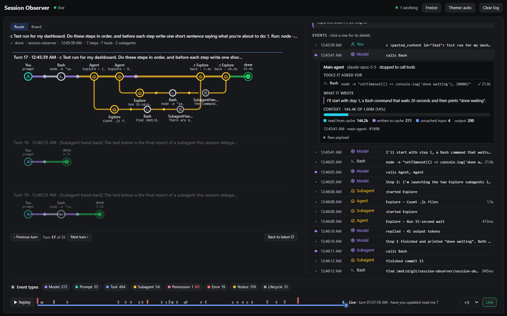
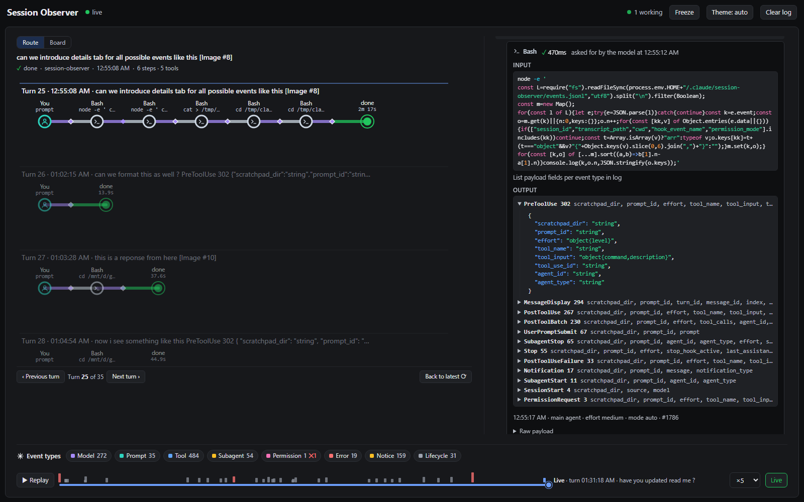

# Session Observer — a Claude Code plugin

[](https://github.com/radekwojpl2/session-observer/actions/workflows/ci.yml)

See everything that happens in your Claude Code sessions on a live local dashboard:
prompts, every tool call (with timing), **skills loaded**, **questions Claude asks you**
(AskUserQuestion + MCP elicitations), subagents, tasks, MCP calls, permission prompts,
failures, notifications, context compactions, model switches, file/cwd changes,
token usage per session, and what the model wrote and which tools it asked for at each step.


## Quick start

Needs Node.js 18+ and Claude Code. No `npm install`.

```bash
git clone https://github.com/radekwojpl2/session-observer.git
claude --plugin-dir ./session-observer      # start Claude Code with the plugin loaded
```

Open **http://localhost:4777** (the server starts on the first session start), or run
`/session-observer:dashboard` inside Claude Code.

**Just want to look?** `node scripts/demo.js` serves made-up sessions, one of them still
working, on **http://localhost:4800**. It doesn't touch `~/.claude`.

| A model step, opened in the turn's details | A tool call with formatted output |
|---|---|
|  |  |

## How it works

```
Claude Code ──(33 async hooks)──▶ scripts/hook.js ──▶ ~/.claude/session-observer/events.jsonl
                                                                │ (tailed)
                                    browser ◀──SSE── server/server.js (127.0.0.1:4777)
```

* **Zero dependencies** — plain Node.js (18+).
* **Never slows Claude down** — every hook is `async: true`, always exits 0.
* **Works even if the dashboard is closed** — events go to a JSONL file first; the
  server catches up when it starts.
* **Local only** — the server binds to `127.0.0.1`. Nothing leaves your machine.

## Install

**Try it without installing:**
```bash
claude --plugin-dir /path/to/session-observer
```

**Install via a local marketplace** (this folder is also a marketplace):
```
/plugin marketplace add /path/to/session-observer
/plugin install session-observer@session-observer-marketplace
```
Or straight from GitHub:
```
/plugin marketplace add radekwojpl2/session-observer
/plugin install session-observer@session-observer-marketplace
```

Restart Claude Code after installing — hooks load at session start.

## Use

The server starts automatically on the first `SessionStart`. Open
**http://localhost:4777**, or run `/session-observer:dashboard` inside Claude Code.

Run it manually: `node server/server.js`.

Dashboard:
* filter bar — time range, full-text search, tool group, "only problems"
* top panels — "All activity" plus every session in range (working / live / ended); session
  stats and its turns; and the selected turn's details (`[` / `]` step through turns, `Esc`
  closes)
* stage — two views of the session, switched at its top left:
  * **Route** — each turn drawn as a metro line. The main line runs along the top, starting
    with your prompt; every model step (◆) and tool call is a stop. Each subagent forks
    down from its Agent call onto its own lane and rises back into the main line when it
    hands back. Long turns wrap onto the next row. Hover a line to highlight that branch.
    While a turn runs, a **Now:** line says what it is doing (a running tool, subagents
    working, waiting for your permission, or the model generating) and shows the model's
    latest words
  * **Board** — a card per tool group with counts, a 15-minute sparkline and what is
    running now, around a core with the context-window gauge
* turn details — prompt, reply and every event. Click a row to open it as a card: tool
  calls show their input and output shaped per tool (coloured shell / Python / JavaScript
  commands, Edit diffs, formatted JSON output); model steps show why the model stopped, the
  tool calls it asked for, what it wrote and a context-window bar; subagents show the task
  they were given. The raw hook payload stays folded under every card. Hovering a row
  lights up its stop on the Route
* bottom — event-type chips and a **replay** bar with one tick per turn: drag to scrub,
  ▶ Replay at ×1–×25, Live to return

Model steps, what the model wrote and the tool calls it asked for come from the session
transcript (each assistant API response), since hooks don't see them.

## What's captured

All hook events Claude Code exposes: `SessionStart, Setup, UserPromptSubmit,
UserPromptExpansion, PreToolUse, PermissionRequest, PermissionDenied, PostToolUse,
PostToolUseFailure, PostToolBatch, Notification, MessageDisplay, SubagentStart,
SubagentStop, TaskCreated, TaskCompleted, Stop, StopFailure, TeammateIdle,
InstructionsLoaded, ConfigChange, CwdChanged, DirectoryAdded, FileChanged,
WorktreeCreate, WorktreeRemove, PreCompact, PostCompact, PreModelSwitch,
PostModelSwitch, Elicitation, ElicitationResult, SessionEnd`.

Token usage comes from the session transcript (`transcript_path`), including subagent
transcripts, refreshed when a turn ends.

The model's text (and thinking, when the transcript keeps it) is read from the transcript
once each block is finished, so it shows up a moment after Claude writes it, not word by
word. Thinking is often stored empty, in which case there is nothing to show.

## Config (env vars)

| Variable | Default | |
|---|---|---|
| `OBSERVER_PORT` | `4777` | dashboard port |
| `OBSERVER_DATA_DIR` | `~/.claude/session-observer` | where `events.jsonl` lives |
| `OBSERVER_MAX_FIELD` | `8000` | max chars kept per string (file contents, outputs) |
| `OBSERVER_MAX_EVENTS` | `5000` | events kept in memory per session |
| `OBSERVER_AUTOSTART` | `1` | set `0` to stop SessionStart from launching the server |
| `OBSERVER_HOST` | `127.0.0.1` | bind address — keep it local |

## Privacy

The log holds your prompts, commands and tool outputs in plain text. Use **Clear log** in
the dashboard or delete `~/.claude/session-observer/events.jsonl`.

## Development

```bash
node test/check.js                 # JSON, JS syntax, hook wiring, version
node --test test/smoke.test.js     # hook → log → server → API, end to end
claude plugin validate .           # plugin + marketplace manifests
```

CI (`.github/workflows/ci.yml`) runs all three on every push and PR, on Node 18–24 (Linux)
and Node 22 on macOS and Windows.

**Releasing:** bump `version` in `.claude-plugin/plugin.json`, commit, then
`git tag vX.Y.Z && git push origin vX.Y.Z`. The release workflow re-runs CI, checks the tag
matches the version, and publishes a GitHub release with a zip and its SHA-256.

## Credits

Earlier versions of the dashboard had a live hub map based on
[**lot-map**](https://github.com/alexeyw/lot-map) by alexeyw (MIT), a Claude Code plugin that
draws a live map of the session beside the chat. The hub map has since been replaced by the
Route and Board views, but the idea of grouping tools into stations (You, Model, Files,
Shell, Git, MCP, Network, Browser, Agents, Skills, Context, Other) and the event markers
(● running · ✕ failed · ◆ model step) come from its design. No code was copied.

## License

[MIT](LICENSE)
