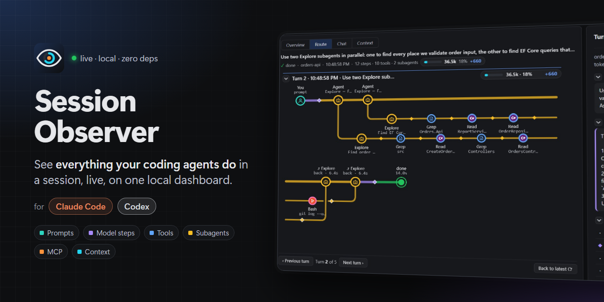

# Session Observer

**One local dashboard for Claude Code and Codex.** Follow prompts, tool calls, model steps, subagents, context use and failures as they happen.

## Screenshots

Screenshots use the synthetic demo sessions.

*Home: see sessions and what needs attention.*

*Overview: turns, tools, context and failures.*

*Route: follow a turn through tools and agents.*

*Chat: prompts, replies and tool calls.*

*Context: inspect usage and transcript records.*

## How it works

~~~mermaid
flowchart LR
  C[Claude Code] -->|plugin hooks| H[scripts/hook.js]
  X[Codex] -->|plugin hooks or CLI config| H
  H -->|append events| L[(~/.claude/session-observer/events.jsonl)]
  L --> S[Local Node server]
  S -->|HTTP and live updates| D[Dashboard in your browser]
  S -. reads transcript when needed .-> T[Claude transcript or Codex rollout]
~~~

Both integrations write events to one local log. The dashboard keeps sessions separate, labels each one by agent, and reads transcripts when a view needs message or context detail.

## Install

Needs Node.js 18 or newer. There is no npm install and no build step.

### Claude Code

The plugin installs Claude Code hooks and starts the dashboard when a session begins.

From a local clone:

~~~sh
claude --plugin-dir ./session-observer
~~~

Or install from the marketplace:

~~~text
/plugin marketplace add radekwojpl2/session-observer
/plugin install session-observer@session-observer-marketplace
~~~

Restart Claude Code after installing so the hooks load.

### Codex

Codex can load the hooks as a desktop plugin or from its CLI hook config.

**Codex desktop app:** add the marketplace, then install Session Observer in the desktop app. Adding a marketplace alone does not activate its hooks:

~~~sh
codex plugin marketplace add radekwojpl2/session-observer
~~~

**Codex CLI:** from this repository, add the hooks to your Codex config:

~~~sh
node scripts/setup-codex.js
~~~

The setup script keeps your existing hooks. Run it again if you move this repository. To remove only these hooks, run:

~~~sh
node scripts/setup-codex.js --remove
~~~

On first use, open /hooks in Codex and trust the Session Observer hooks. The dashboard starts on the first session if it is not already running.

## Claude Code and Codex: what differs

| | Claude Code | Codex |
|---|---|---|
| Hook setup | Installed with the Claude Code plugin | Desktop plugin or CLI setup script |
| Event source | Claude Code hook events | Codex hook events, including model request and usage events |
| Message and context source | Claude session transcript | Codex rollout file in ~/.codex/sessions |
| Context detail | Transcript, instructions, tools, skills and attachments when recorded | Rollout parser reads prompts, replies, tool activity and context metadata |
| Reasoning | Shown when the transcript provides it | Codex stores reasoning encrypted; only available summaries are readable |
| Dashboard | Same local dashboard and event log | Same local dashboard and event log |

## Tricky details

- **Hooks stay out of the way.** The hook writes events quickly, swallows errors and exits successfully so it does not block the coding session.
- **The sessions are not merged.** Claude Code and Codex sessions share a dashboard, but each keeps its own transcript and session identity.
- **Codex hooks need trust.** Trust them once in Codex with /hooks. The CLI script preserves your other hooks, but its paths point to this clone.
- **Context sizes are estimates.** Transcript formats and token counts differ by agent. Codex's rollout format is undocumented and may change; encrypted reasoning text cannot be recovered by the dashboard.
- **The server is local.** It binds to 127.0.0.1 by default. The event log contains prompts, commands and tool output in plain text.

## Use

The first session starts the server automatically. Open [http://localhost:4777](http://localhost:4777). To start it manually:

~~~sh
node server/server.js
~~~

Try a synthetic demo without writing to your real event log:

~~~sh
node scripts/demo.js
~~~

The demo opens at http://localhost:4800.

### Dashboard languages

The dashboard follows your browser language. Choose another from the language menu; the selection is saved.

| Code | Language |
|---|---|
| en | English |
| de | Deutsch |
| es | Español |
| fr | Français |
| it | Italiano |
| ja | 日本語 (Japanese) |
| ko | 한국어 (Korean) |
| pl | Polski |
| pt | Português |
| zh | 简体中文 (Chinese, Simplified) |

Want another language? [Open an issue to request one](https://github.com/radekwojpl2/session-observer/issues/new).

## Config

| Variable | Default | Purpose |
|---|---:|---|
| OBSERVER_PORT | 4777 | Dashboard port |
| OBSERVER_DATA_DIR | ~/.claude/session-observer | Event log directory |
| OBSERVER_AUTOSTART | 1 | Set to 0 to disable automatic start |
| OBSERVER_HOST | 127.0.0.1 | Bind address |
| OBSERVER_MAX_EVENTS | 5000 | Events kept per session |
| OBSERVER_CONTEXT_FIELD | 100000 | Maximum characters shown per context field |
| OBSERVER_CODEX_CONTEXT_WINDOW | 272000 | Fallback Codex context window, in tokens |

## Development

~~~sh
node test/check.js
node --test test/*.test.js
~~~

## License

[MIT](LICENSE)
