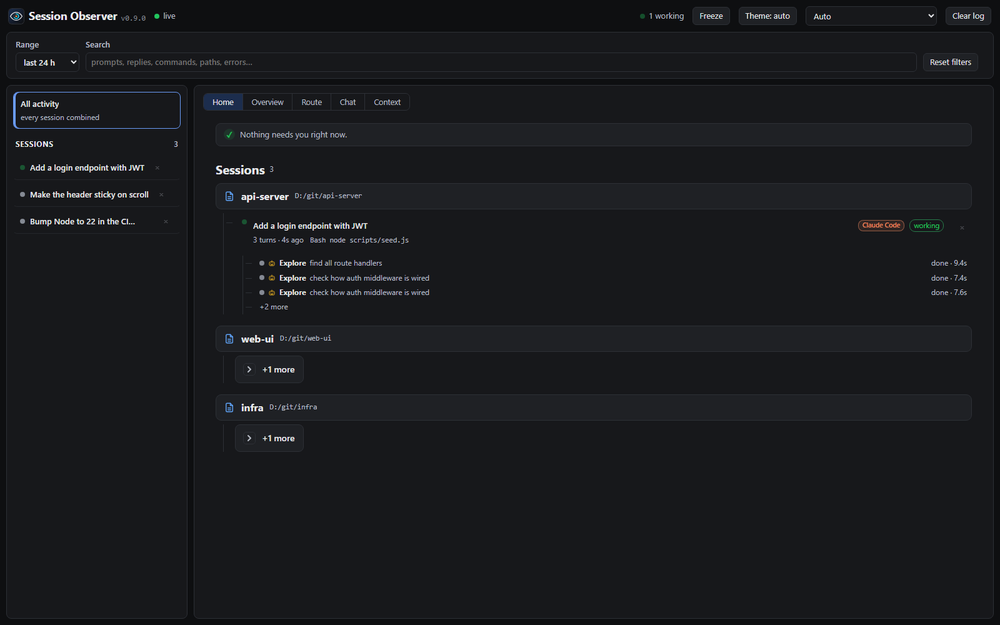
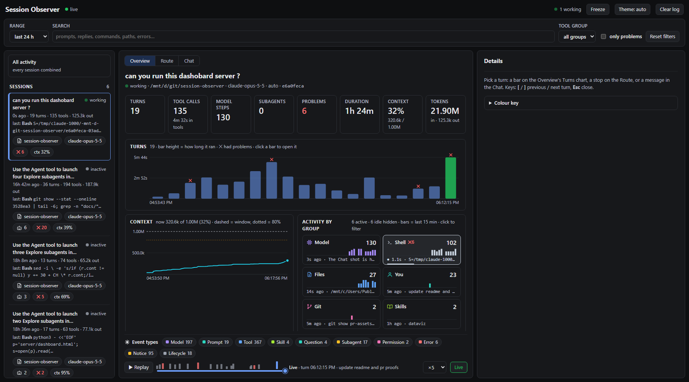
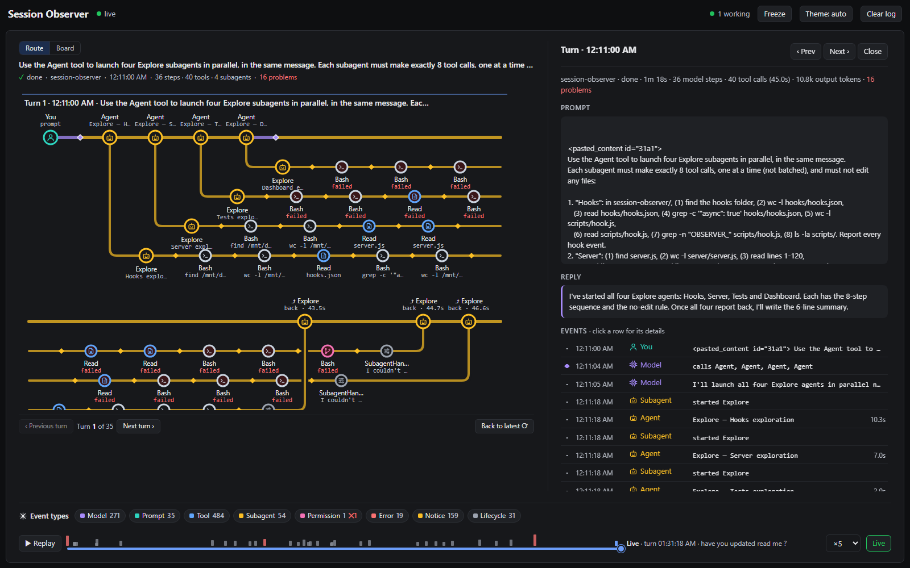
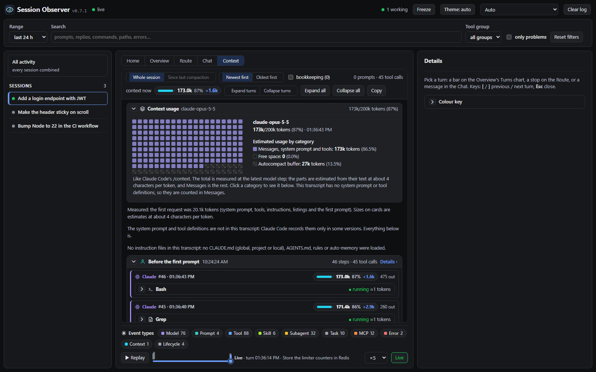

<p align="center"></p>

# Session Observer

**One local dashboard for Claude Code and Codex.** Follow prompts, tool calls, model steps, subagents, context use and failures as they happen.

[](https://github.com/radekwojpl2/session-observer/actions/workflows/ci.yml)

## Screenshots

Screenshots use the synthetic demo sessions.



*Home: see sessions and what needs attention.*



*Overview: turns, tools, context and failures.*



*Route: follow a turn through tools and agents.*


*Chat: prompts, replies and tool calls.*



*Context: inspect usage and transcript records.*

## How it works

~~~mermaid
flowchart LR
  C[Claude Code] -->|plugin hooks| H[scripts/hook.js]
  X[Codex] -->|plugin hooks or CLI config| H
  H -->|append by day and session| L[(~/.claude/session-observer/sessions/DAY/*.jsonl)]
  L -->|recent days at start, older on request| S[Local Node server]
  S -->|HTTP and live updates| D[Dashboard in your browser]
  S -. reads transcript when needed .-> T[Claude transcript or Codex rollout]
~~~

Both integrations append each event to a JSONL file for its session inside a folder for the current UTC day. The server keeps sessions in memory. At start it reads only the last few days, and the dashboard can load older days on request. The dashboard labels sessions by agent and reads transcripts when a view needs message or context detail.

### Event storage

Each hook call appends one line to `sessions/<YYYY-MM-DD>/<sha256(session_id)>.jsonl`. The hash keeps any session id safe to use as a file name. **A session is never split:** it has exactly one file, in the folder of the UTC day it was last active. When a session sends its first event of a new day, the hook moves its file from the earlier day's folder into today's before appending. It also removes the earlier folder if that leaves it empty.

```
~/.claude/session-observer/
  sessions/
    2026-11-14/0d2e….jsonl     ← session C, last active on the 14th
    2026-11-21/3f9a….jsonl     ← session A, started on the 20th, moved here by its first event on the 21st
    2026-11-21/b71c….jsonl     ← session B
  deleted-sessions.jsonl       ← ids and times of deleted sessions
  events.jsonl                 ← only while an older plugin's hook still writes here
```

~~~mermaid
sequenceDiagram
  participant A as Claude Code / Codex
  participant H as hook.js
  participant F as sessions/DAY/HASH.jsonl
  participant S as server.js (every 400 ms)
  participant M as In-memory sessions
  participant D as Dashboard
  A->>H: hook event (stdin JSON)
  H->>F: first event today? move the file from its earlier day
  H->>F: append one line, exit 0
  S->>F: list loaded day folders, read bytes after each file's offset
  Note over S,F: A known file found in a newer folder was moved:<br/>same bytes, so its read offset is kept
  S->>M: ingest (status, needs-you, totals)
  S-->>D: SSE "event" and "session"
  D->>S: GET /api/sessions, /api/events, /api/history
~~~

#### How a session stays in one file

The hook moves a session's file forward to today instead of starting a new one. Three parts work together.

**1. The hook moves the file.** Before appending, `sessionLogForAppend` in `server/lib/building-blocks/session-logs.js` (called by `scripts/hook.js`) picks the file:

```
target = sessions/<today>/<hash>.jsonl
if target exists               → append there           (every event after the day's first)
else look in earlier day folders, newest first:
  found sessions/<older>/<hash>.jsonl
    → rename it to target, then append there
    → remove <older>/ if it is now empty
not found anywhere             → create target          (a new session)
```

~~~mermaid
sequenceDiagram
  participant H as hook.js
  participant Old as sessions/2026-11-20/3f9a.jsonl
  participant New as sessions/2026-11-21/3f9a.jsonl
  Note over H: first event of session A on the 21st
  H->>New: exists? no
  H->>Old: exists? yes
  H->>New: rename Old to New (same bytes)
  H->>New: append the event
  Note over H: later events on the 21st
  H->>New: exists? yes, append
~~~

Only a session's first event of a day costs extra: up to one existence check per day folder, plus one rename. Every later event that day finds today's file on the first check.

Claude Code can fire several hooks at once:
- **Two hooks race to move the file.** The rename that loses fails, finds the file already at the target, and appends there.
- **The rename is refused.** On Windows, this can happen while another process has the file open. The hook appends to the file where it is, so the session still has one file, and the next event tries the move again.

**2. The server follows a moved file.** `server/server.js` tracks each session file by its name (the session hash), not by its full path. On every poll, it finds where that name now lives, in the newest loaded day folder:
- **Same path as before:** it reads the new bytes.
- **New path, old path gone:** the hook moved the file. The bytes are the same, so the server points its reader at the new path and keeps its read position. Nothing is read twice.
- **A name it hasn't seen:** it reads the file from the start.

**3. The import also writes one file per session.** When the server copies the former combined `events.jsonl` into the day folders, it groups lines by session. Each session goes into the file it already has, or into a new file in the folder of the day of its last event. A session in the old log that ran from the 1st to the 2nd ends up in a single file under `2026-01-02/`.

**Fallback.** A session can still end up in two folders: when a brand-new session sends its first two events at the same moment on both sides of midnight UTC, each hook creates a file. The server then reads the older file first and the newer one after it, so the session's events stay in order.

**What a start reads.** The server reads the day folders from the last `OBSERVER_LOAD_DAYS` days (7 by default, today included). Because a session's file sits in the folder of its last active day, this covers every session active in those days, however long ago it started. Older day folders stay on disk until **Load sessions before …** in the session list loads the next batch. The dashboard's time range still filters what it shows, so pick a longer range to see older sessions.

~~~mermaid
flowchart TD
  Start([server start]) --> Import[Move events.jsonl and its unfinished imports into day folders, skipping deleted sessions]
  Import --> Window[Read day folders from the last OBSERVER_LOAD_DAYS days]
  Window --> Ready([serve the dashboard])
  Ready -->|POST /api/history/older| Older[Read the next batch of older day folders]
  Older --> Ready
~~~

**The import from the former combined log.** At every start, the server renames `events.jsonl` to `events.<time>.migrating`, then copies each line into its session's one file: the file the session already has, or a new one in the folder of the day of its last event. Renaming first means a hook from an older plugin that appends meanwhile starts a new `events.jsonl`, and no line is lost. Each copied line carries its source and byte offset, so an interrupted import resumes without copying a line twice. Until the next start, the server also tails the new `events.jsonl`.

**Deleting a session** (× in the dashboard, `DELETE /api/sessions/<id>`) removes its file and drops its in-memory state. It also appends the id and the time to `deleted-sessions.jsonl`. An older plugin's hook may have written that session to `events.jsonl`; the import skips those lines, so the session does not come back after a restart. Events of the same id written after the delete start a new entry.

#### Alternatives considered

| Approach | Pros | Cons |
|---|---|---|
| **One combined `events.jsonl`** (before this change) | Simplest; one file to tail | Every start reads everything; grows forever; deleting one session means rewriting the whole file while hooks append to it |
| **Per-session JSONL, flat** | Deleting a session is one `unlink` | Every start still reads every session ever recorded |
| **Per-session JSONL + SQLite index** (an earlier version of this change) | Event queries come from SQL; the index can always be rebuilt from JSONL | Needs Node 22.13 (`node:sqlite`) and WAL files. Memory and SQLite were two sources of truth, and each start still replayed everything into both, so the index made nothing faster |
| **Per-session JSONL + SQLite with saved tail offsets** | Incremental start; memory stays bounded | Needs Node 22.13; session summaries must be stored or rebuilt as well, not only events |
| **SQLite only, written by the hook** | One store; real transactions | The hook would wait on a database lock, but it must never block the agent; a corrupt database loses data with no plain-text copy |
| **Day files shared by all sessions** (`events-<day>.jsonl`) | Start reads only recent days; old days are easy to drop | Deleting one session rewrites every day file it is in while hooks append; rebuilding a session that runs past midnight scans other sessions' events |
| **Combined JSONL + tombstones and compaction** | One file; delete appends a tombstone line | Deleted data stays on disk until compaction runs; compaction must coordinate with appending hooks |
| **Day folders with per-session files, split at midnight** | Start reads only recent days; the hook only appends | A session has a file in every day it was active, so the server must find and merge its earlier days |
| **Day folders with one file per session, moved to its last active day** (this change) | Start reads only recent days, which covers every session active in them; a session is never split; deleting a session is one `unlink`; a day folder can be deleted as a whole; Node 18+ | Older sessions need **Load sessions before …**; a session's first event of a day searches earlier folders and renames its file |

## Install

Needs Node.js 18 or newer. There is no npm install and no build step.

### Claude Code

The plugin installs Claude Code hooks and starts the dashboard when a session begins.

From a local clone:

~~~sh
claude --plugin-dir ./session-observer
~~~

Or install from the marketplace:

~~~text
/plugin marketplace add radekwojpl2/session-observer
/plugin install session-observer@session-observer-marketplace
~~~

Restart Claude Code after installing so the hooks load.

To update later, run `/session-observer:update` in Claude Code. It updates the marketplace and the plugin (reinstalling if the version did not change), stops the old dashboard server and starts the new one.

### Codex

Codex can load the hooks as a desktop plugin or from its CLI hook config.

**Codex desktop app:** add the marketplace, then install Session Observer in the desktop app. Adding a marketplace alone does not activate its hooks:

~~~sh
codex plugin marketplace add radekwojpl2/session-observer
~~~

**Codex CLI:** from this repository, add the hooks to your Codex config:

~~~sh
node scripts/setup-codex.js
~~~

The setup script keeps your existing hooks. Run it again if you move this repository. To remove only these hooks, run:

~~~sh
node scripts/setup-codex.js --remove
~~~

On first use, open /hooks in Codex and trust the Session Observer hooks. The dashboard starts on the first session if it is not already running.

## Claude Code and Codex: what differs

| | Claude Code | Codex |
|---|---|---|
| Hook setup | Installed with the Claude Code plugin | Desktop plugin or CLI setup script |
| Event source | Claude Code hook events | Codex hook events, including model request and usage events |
| Message and context source | Claude session transcript | Codex rollout file in ~/.codex/sessions |
| Context detail | Transcript, instructions, tools, skills and attachments when recorded | Rollout parser reads prompts, replies, tool activity and context metadata |
| Reasoning | Shown when the transcript provides it | Codex stores reasoning encrypted; only available summaries are readable |
| Dashboard | Same local dashboard and event log | Same local dashboard and event log |

## Tricky details

- **Hooks stay out of the way.** The hook writes events quickly, swallows errors and exits successfully so it does not block the coding session.
- **Remove one session's Observer data.** Use its × button on Home or in the session list to delete its JSONL file. If the agent is still running, later events can create a new entry. Its original Claude Code or Codex transcript is not deleted.
- **The sessions are not merged.** Claude Code and Codex sessions share a dashboard, but each keeps its own transcript and session identity.
- **Codex hooks need trust.** Trust them once in Codex with /hooks. The CLI script preserves your other hooks, but its paths point to this clone.
- **Context sizes are estimates.** Transcript formats and token counts differ by agent. Codex's rollout format is undocumented and may change; encrypted reasoning text cannot be recovered by the dashboard.

## Privacy and stored data

Session Observer writes hook events to `~/.claude/session-observer/sessions/<day>/<session-hash>.jsonl`. At each start, the server moves the former combined `events.jsonl` into these folders. Until their plugin is updated, older installed hooks keep appending to that file, and the server tails it. `deleted-sessions.jsonl` keeps the ids and times of deleted sessions, so that import skips them. Session logs can contain prompts, commands and tool output. The server binds to `127.0.0.1` by default and reads Claude transcripts or Codex rollouts locally when needed. Treat them as sensitive.

To clear Observer's event history, stop the server and delete the `sessions` directory, `events.jsonl` and `deleted-sessions.jsonl` from the configured data directory. To drop only old history, delete the day folders you no longer need (`~/.claude/session-observer` by default). This does not delete the original Claude or Codex transcripts.

## Troubleshooting

- **No sessions appear:** start a new Claude Code or Codex session after installing. For Codex, open `/hooks` and trust Session Observer; for Codex CLI, rerun `node scripts/setup-codex.js` if you moved the repository.
- **The dashboard does not open:** start it with `node server/server.js`. If port 4777 is already in use, start it on another port:

  ~~~powershell
  $env:OBSERVER_PORT=4778; node server/server.js
  ~~~

  In Command Prompt, use `set OBSERVER_PORT=4778&& node server/server.js`.
- **Events appear, but transcript details are missing:** transcript and context views read the source app's local transcript or rollout. Confirm the file is available to the same user running the dashboard.

## Uninstall

- **Claude Code:** open `/plugin` and uninstall Session Observer from the installed plugins.
- **Codex desktop:** remove Session Observer from the app's plugin manager.
- **Codex CLI:** from the repository, run `node scripts/setup-codex.js --remove` before deleting or moving the clone. This removes only Session Observer hooks and keeps your other hooks.

To remove saved Observer events as well, stop the server and delete the event files described above.

## Use

The first session starts the server automatically. Open [http://localhost:4777](http://localhost:4777). To start it manually:

~~~sh
node server/server.js
~~~

Try a synthetic demo without writing to your real event log:

~~~sh
node scripts/demo.js
~~~

The demo opens at http://localhost:4800.

### Dashboard languages

The dashboard follows your browser language. Choose another from the language menu; the selection is saved.

| Code | Language |
|---|---|
| en | English |
| de | Deutsch |
| es | Español |
| fr | Français |
| it | Italiano |
| ja | 日本語 (Japanese) |
| ko | 한국어 (Korean) |
| pl | Polski |
| pt | Português |
| zh | 简体中文 (Chinese, Simplified) |

Want another language? [Open an issue to request one](https://github.com/radekwojpl2/session-observer/issues/new).

## Config

| Variable | Default | Purpose |
|---|---:|---|
| OBSERVER_PORT | 4777 | Dashboard port |
| OBSERVER_DATA_DIR | ~/.claude/session-observer | Event log directory |
| OBSERVER_AUTOSTART | 1 | Set to 0 to disable automatic start |
| OBSERVER_HOST | 127.0.0.1 | Bind address |
| OBSERVER_MAX_EVENTS | 5000 | Events kept per session |
| OBSERVER_LOAD_DAYS | 7 | Days of session folders read at start, today included; 0 reads every day |
| OBSERVER_CONTEXT_FIELD | 100000 | Maximum characters shown per context field |
| OBSERVER_CODEX_CONTEXT_WINDOW | 272000 | Fallback Codex context window, in tokens |

## Development

~~~sh
node test/check.js
node --test test/*.test.js
~~~

## License

[MIT](LICENSE)
