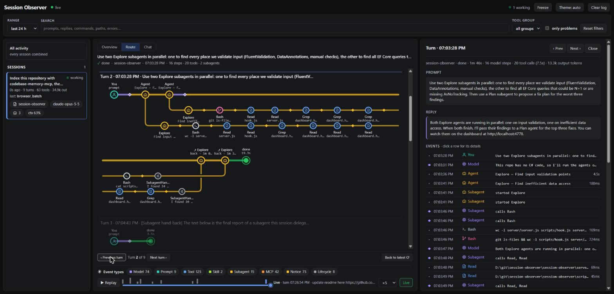
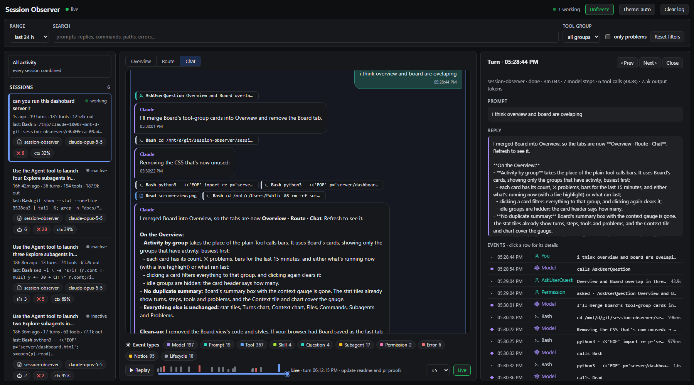
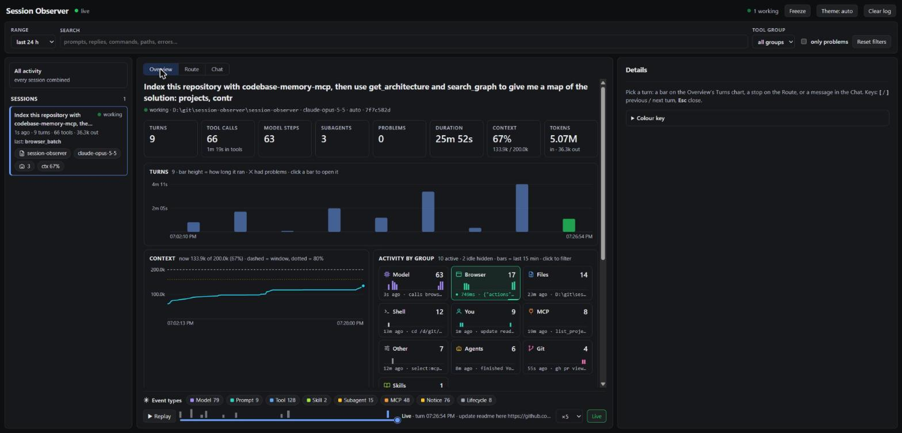
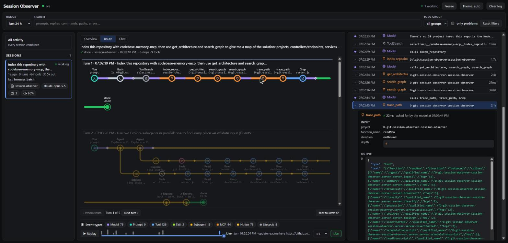
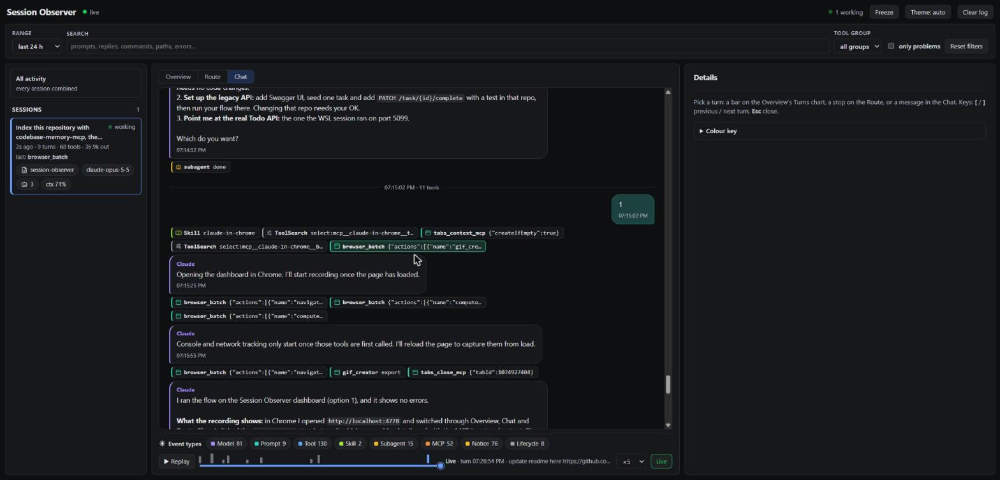

# Session Observer — a Claude Code plugin

[](https://github.com/radekwojpl2/session-observer/actions/workflows/ci.yml)

See everything that happens in your Claude Code sessions on a live local dashboard:
prompts, every tool call (with timing), **skills loaded**, **questions Claude asks you**
(AskUserQuestion + MCP elicitations), subagents, tasks, MCP calls, permission prompts,
failures, notifications, context compactions, model switches, file/cwd changes,
token usage per session, and what the model wrote and which tools it asked for at each step.



## Quick start

Needs Node.js 18+ and Claude Code. No `npm install`.

```bash
git clone https://github.com/radekwojpl2/session-observer.git
claude --plugin-dir ./session-observer      # start Claude Code with the plugin loaded
```

Open **http://localhost:4777** (the server starts on the first session start), or run
`/session-observer:dashboard` inside Claude Code.

**Just want to look?** `node scripts/demo.js` serves made-up sessions, one of them still
working, on **http://localhost:4800**. It doesn't touch `~/.claude`.

| Overview: charts and details for the session | Chat: the conversation as a messenger |
|---|---|
|  |  |
| **A model step, opened in Details** | **A tool call with formatted output** |
|  |  |

### A real session, screen by screen

These four screens come from one real 25-minute session recorded with the plugin. In nine
turns it indexed this repo with the codebase-memory MCP server, ran two Explore subagents in
parallel and then a Plan subagent, drove Chrome through Claude in Chrome, and loaded a skill.

**Overview: the whole session at a glance**



* **Tiles** (top row): 9 turns, 66 tool calls (1m 19s spent inside tools), 63 model steps,
  3 subagents, 0 problems, 25m 52s duration, context 67% full (133.9k of 200k), 5.07M tokens
  in and 36.3k out.
* **Turns**: one bar per turn. The tallest bar (over 4 minutes) is the turn that drove Chrome
  and recorded a GIF. The green bar on the right is the turn still running.
* **Context**: how the context window filled up during the session. It rises at each turn and
  stays well under the dotted 80% line, so nothing was compacted.
* **Activity by group**: every tool group in use, with its count and last-15-minutes
  sparkline. **Browser** (17) is highlighted because a Claude in Chrome call is running right
  now (the dot and the timer on the card). **MCP** (8) counts the codebase-memory calls,
  **Agents** (6) the subagent calls, and **Skills** (1) the loaded `claude-in-chrome` skill.

**Route: two subagents working in parallel** (the screenshot at the top of this README)

* The main line starts at **You** (the prompt) and runs along the top. The model makes two
  **Agent** calls back to back, and each one forks down onto its own lane.
* Each lane is one Explore subagent. Its stops are the tools it used, in order: `Bash`,
  `Read` of `hook.js` and `server.js`, `Grep` over `dashboard.html`. The lanes wrap onto the
  next row when the turn gets long.
* At the end of each lane, **SubagentHandback** ("I found 24…", "I found 20…") is the
  subagent's final report. The lanes rise back into the main line at **Explore back**, and the
  turn ends at **done**.
* **Details** (right) lists the same turn as rows in the order they started: the prompt, the
  two Agent calls, both `started Explore` events, then each subagent's tool calls with their
  run times.

**Route and Details: an MCP call opened as a card**



* Turn 1 is one straight main line, because the model did all the work itself: `Bash`, then
  `ToolSearch` to load the MCP tools, then the orange MCP stops (`index_repository`,
  `get_architecture`, `search_graph` ×2, `trace_path` ×2) and a final `Grep`.
* The selected `trace_path` stop opens as a card in Details: the **input** the model sent
  (project, `function_name: readNew`, `direction: outbound`, `depth: 4`) and the **output**
  the MCP server returned, formatted as JSON. The header shows it took 22 ms and when the
  model asked for it.
* The faded turn below is the next one. Only the selected turn is drawn at full strength.

**Chat: the same session as a conversation**



* Your prompt ("1", choosing an option Claude offered) is on the right; Claude's replies are
  on the left, with light markdown.
* The chips between them are the tool calls in order: the `claude-in-chrome` **Skill**,
  `ToolSearch` loading the browser tools, `tabs_context_mcp`, the `browser_batch` calls that
  drive Chrome, `gif_creator export` and `tabs_close_mcp`. The colour of a chip shows its
  tool group.
* The divider line ("07:15:02 PM · 11 tools") starts each turn, and the **subagent done** chip
  above it marks a subagent that finished in the previous turn.

## How it works

```
Claude Code ──(33 async hooks)──▶ scripts/hook.js ──▶ ~/.claude/session-observer/events.jsonl
                                                                │ (tailed)
                                    browser ◀──SSE── server/server.js (127.0.0.1:4777)
```

* **Zero dependencies** — plain Node.js (18+).
* **Never slows Claude down** — every hook is `async: true`, always exits 0.
* **Works even if the dashboard is closed** — events go to a JSONL file first; the
  server catches up when it starts.
* **Local only** — the server binds to `127.0.0.1`. Nothing leaves your machine.

## Install

**Try it without installing:**
```bash
claude --plugin-dir /path/to/session-observer
```

**Install via a local marketplace** (this folder is also a marketplace):
```
/plugin marketplace add /path/to/session-observer
/plugin install session-observer@session-observer-marketplace
```
Or straight from GitHub:
```
/plugin marketplace add radekwojpl2/session-observer
/plugin install session-observer@session-observer-marketplace
```

Restart Claude Code after installing — hooks load at session start.

## Use

The server starts automatically on the first `SessionStart`. Open
**http://localhost:4777**, or run `/session-observer:dashboard` inside Claude Code.

Run it manually: `node server/server.js`.

The dashboard fits on one screen, in three columns:

* filter bar (above them) — time range, full-text search, tool group, "only problems"
* **Sessions** (left) — "All activity" plus every session in range (working / live / ended)
* **the selected view** (middle) — three tabs:
  * **Overview** — the session's stat tiles, then:
    * **Turns** — one bar per turn, height = how long it ran, ✕ on turns with problems;
      click a bar to open that turn
    * **Context** — how full the context window got over the session (compactions show as drops)
    * **Activity by group** — a card per tool group in use: count, problems, a 15-minute
      sparkline and what is running now or ran last; click a card to filter everything to it
    * **Files**, **Commands**, **Subagents**, **Problems** — the files touched most, shell
      programs run, subagents with their task and run time, and the latest failures; click
      one to open it
  * **Route** — each turn drawn as a metro line. The main line runs along the top, starting
    with your prompt; every model step (◆) and tool call is a stop. Each subagent forks
    down from its Agent call onto its own lane and rises back into the main line when it
    hands back. Long turns wrap onto the next row. Hover a line to highlight that branch.
    While a turn runs, a **Now:** line says what it is doing (a running tool, subagents
    working, waiting for your permission, or the model generating) and shows the model's
    latest words
  * **Chat** — the conversation as a messenger: your prompts on the right, Claude's replies
    on the left (light markdown), thinking in dashed bubbles, and tool calls as chips
    between them (red when they failed, tinted while running)
  * under the views — event-type chips and a **replay** bar with one tick per turn: drag
    to scrub, ▶ Replay at ×1–×25, Live to return
* **Details** (right) — the selected turn: prompt, reply and every event in the order it
  started (`[` / `]` step through turns, `Esc` closes). Each model response is one row: what
  it wrote, then the tools it called. Click a row to open it as a card: tool calls show
  their input and output shaped per tool (coloured shell / Python / JavaScript commands,
  Edit diffs, formatted JSON output); model steps show why the model stopped, the tool calls
  it asked for, what it wrote and a context-window bar; subagents show the task they were
  given. The raw hook payload stays folded under every card

Hovering links the views both ways: an event row in Details lights up its stop on the Route
and its bubble or chip in the Chat, and hovering a Route stop or a Chat item lights up its
row in Details.

Model steps, what the model wrote and the tool calls it asked for come from the session
transcript (each assistant API response), since hooks don't see them.

## What's captured

All hook events Claude Code exposes: `SessionStart, Setup, UserPromptSubmit,
UserPromptExpansion, PreToolUse, PermissionRequest, PermissionDenied, PostToolUse,
PostToolUseFailure, PostToolBatch, Notification, MessageDisplay, SubagentStart,
SubagentStop, TaskCreated, TaskCompleted, Stop, StopFailure, TeammateIdle,
InstructionsLoaded, ConfigChange, CwdChanged, DirectoryAdded, FileChanged,
WorktreeCreate, WorktreeRemove, PreCompact, PostCompact, PreModelSwitch,
PostModelSwitch, Elicitation, ElicitationResult, SessionEnd`.

Token usage comes from the session transcript (`transcript_path`), including subagent
transcripts, refreshed when a turn ends.

The model's text (and thinking, when the transcript keeps it) is read from the transcript
once each block is finished, so it shows up a moment after Claude writes it, not word by
word. Thinking is often stored empty, in which case there is nothing to show.

## Config (env vars)

| Variable | Default | |
|---|---|---|
| `OBSERVER_PORT` | `4777` | dashboard port |
| `OBSERVER_DATA_DIR` | `~/.claude/session-observer` | where `events.jsonl` lives |
| `OBSERVER_MAX_FIELD` | `8000` | max chars kept per string (file contents, outputs) |
| `OBSERVER_MAX_EVENTS` | `5000` | events kept in memory per session |
| `OBSERVER_AUTOSTART` | `1` | set `0` to stop SessionStart from launching the server |
| `OBSERVER_HOST` | `127.0.0.1` | bind address — keep it local |

## Privacy

The log holds your prompts, commands and tool outputs in plain text. Use **Clear log** in
the dashboard or delete `~/.claude/session-observer/events.jsonl`.

## Development

```bash
node test/check.js                 # JSON, JS syntax, hook wiring, version
node --test test/smoke.test.js     # hook → log → server → API, end to end
claude plugin validate .           # plugin + marketplace manifests
```

CI (`.github/workflows/ci.yml`) runs all three on every push and PR, on Node 18–24 (Linux)
and Node 22 on macOS and Windows.

**Releasing:** bump `version` in `.claude-plugin/plugin.json`, commit, then
`git tag vX.Y.Z && git push origin vX.Y.Z`. The release workflow re-runs CI, checks the tag
matches the version, and publishes a GitHub release with a zip and its SHA-256.

## Credits

Earlier versions of the dashboard had a live hub map based on
[**lot-map**](https://github.com/alexeyw/lot-map) by alexeyw (MIT), a Claude Code plugin that
draws a live map of the session beside the chat. The hub map has since been replaced by the
Overview, Route and Chat views, but the idea of grouping tools into stations (You, Model, Files,
Shell, Git, MCP, Network, Browser, Agents, Skills, Context, Other) and the event markers
(● running · ✕ failed · ◆ model step) come from its design. No code was copied.

## License

[MIT](LICENSE)
